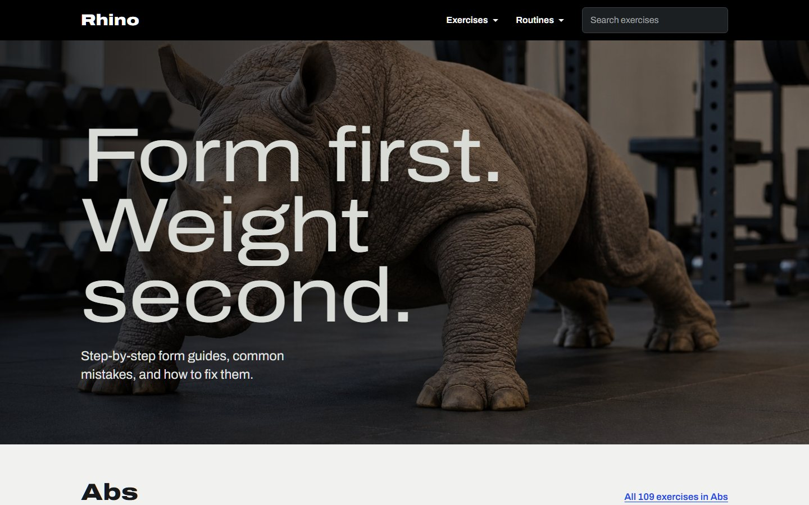
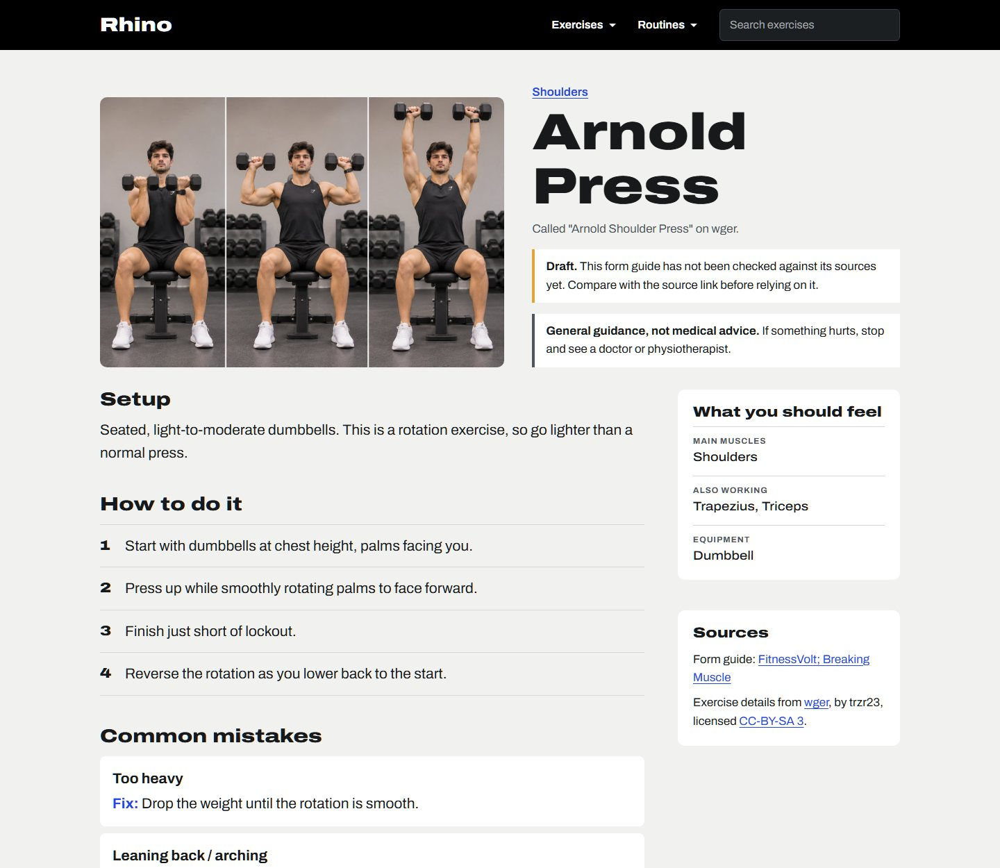
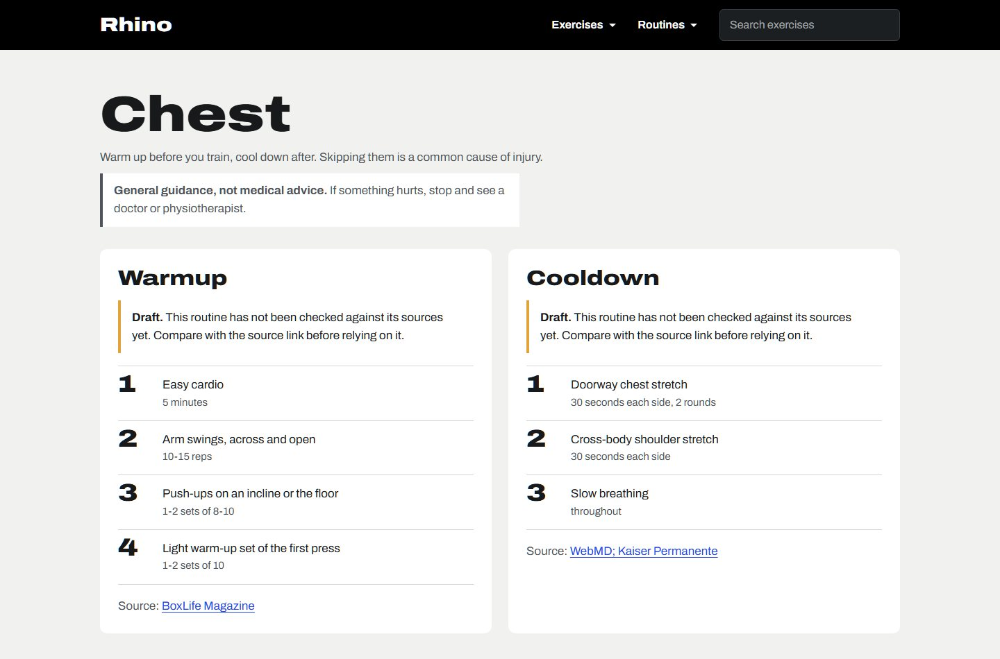

# Rhino: exercise form guides

**Form first. Weight second.**

Rhino helps you do exercises with proper form, to avoid injury and train effectively.
For each exercise it shows the setup, step-by-step form, common mistakes and how to
fix them, and the muscles you should feel working. It also has warmup and cooldown
routines per body part, because skipping them is a common cause of injury.

> General guidance, not medical advice. If something hurts, stop and see a doctor or
> physiotherapist.



| Exercise page | Warmup and cooldown |
|---|---|
|  |  |

## Features

- **905 exercises** in 8 categories, from the open [wger](https://wger.de) catalogue,
  with muscles, equipment and pictures.
- **26 hand-written form guides**: setup, numbered steps, common mistakes with fixes,
  form pictures, and a YouTube demo link. Every guide names its sources.
- **Warmup and cooldown routines** for 6 body parts.
- **Search** with keyboard support, category pages, and a layout that works on phones.
- Exercises without a guide still show wger's data, marked "Form guide not written yet".

## Tech stack

- **Backend:** Python, FastAPI, uvicorn
- **Database:** SQLite
- **Data import:** httpx (calls the wger REST API)
- **Frontend:** plain HTML, CSS and JavaScript, served by FastAPI (no framework, no build step)

## How it works

The data comes in two layers that are kept apart:

```
wger API ──ingest_wger──┐
                        ├──> SQLite (data/app.db) ──> FastAPI /api/... ──> page (app.js)
my JSON + pictures ──load_all──┘
```

1. **wger catalogue (automatic).** `ingest_wger.py` downloads every English exercise
   from `https://wger.de/api/v2/exerciseinfo/` page by page and saves names,
   categories, muscles, equipment and image links.
2. **My form layer (hand-written).** Form guides and routines are JSON files in
   `data/form_content/`, my own pictures are in `data/form_images/` and
   `data/main_images/`. The loaders read these into their own tables. The wger
   import never touches them.
3. **API.** FastAPI only *reads* the database and sends JSON to the page.
   Content is changed by editing the files and running the loaders, never through the website.

## Run it locally

Built and tested with Python 3.13. From the project folder (Windows PowerShell):

```powershell
# 1. Create the virtual environment and install packages
python -m venv .venv
.venv\Scripts\python -m pip install -r requirements.txt

# 2. Fill the database (the database file is not in git)
.venv\Scripts\python -m backend.app.ingest_wger   # downloads from wger, needs internet, run once
.venv\Scripts\python -m backend.app.load_all      # my guides, routines and pictures

# 3. Start the server
.venv\Scripts\python -m uvicorn backend.app.main:app --reload
```

Then open http://127.0.0.1:8000. The API docs are at http://127.0.0.1:8000/docs.

On macOS or Linux, use `.venv/bin/python` instead of `.venv\Scripts\python`.

After editing anything in `data/`, run `load_all` again. All loaders are safe to run
again and again: they update what is there and never create duplicates.

## Project structure

```
backend/app/
  main.py                   FastAPI app: the page, pictures and the /api routes
  db.py, schema.sql         database connection and tables
  ingest_wger.py            imports the wger catalogue
  load_all.py               runs my loaders in the right order:
    load_custom_exercises.py  exercises that are not in wger (ids from 1,000,000)
    load_form_content.py      form guides, steps and mistakes
    load_routines.py          warmup and cooldown routines
    load_images.py            my form and main pictures
frontend/
  index.html, app.js, styles.css   the single-page site (routes like #/exercise/20)
  assets/hero.jpg                  home page picture
data/
  form_content/*.json       my form guides and routines (with sources)
  custom_exercises.json     my exercises that wger does not have
  form_images/, main_images/   my pictures, named 1.jpg, 2.jpg ... in display order
  app.db                    the SQLite database (created locally, not in git)
docs/screenshots/           pictures for this README
```

## API

| Route | Returns |
|---|---|
| `GET /api/categories` | categories with exercise counts |
| `GET /api/categories/{id}/exercises` | exercises in a category (paged) |
| `GET /api/search?q=...` | exercises matching a name |
| `GET /api/exercises/{id}` | one exercise: muscles, equipment, pictures, form guide, credits |
| `GET /api/guides` | exercises that have a form guide |
| `GET /api/routines` | body parts that have routines |
| `GET /api/routines/{body_part}` | warmup and cooldown for one body part |
| `GET /health` | server and database check |

## Design decisions

- **Two data layers.** wger data and my own content live in separate tables, so
  re-importing wger can never overwrite a form guide I wrote.
- **Copy wger into my own database** instead of calling wger on every page view:
  faster, the text still works when wger is down, and I control the shape of the data.
  (wger's photos are still loaded from wger.de.)
- **Safe to re-run.** The wger import and all my loaders upsert (insert or update),
  so running them again never creates duplicates. My loaders also check all input
  first and write in one transaction: either everything is saved, or nothing.
- **Link tables** for the many-to-many relations (exercise and muscle, exercise and equipment).
- **Security basics.** SQL always uses `?` placeholders, never joined strings
  (no SQL injection). The page shows data with `textContent`, never `innerHTML`
  (no script injection). The server shares only the folders meant to be public,
  never `data/` as a whole, because the database lives there.
- **No CORS needed.** FastAPI serves the page and the API from the same address.
- **Gaps in wger are expected.** Missing pictures, descriptions or fields are handled
  without crashing.
- **Fresh files after every change.** Static files are sent with `Cache-Control: no-cache`,
  so the browser checks for a new version (a cheap `304 Not Modified` if nothing changed).

## Content status

The form guides and routines are marked as **drafts** until I have checked each one
against its sources. The site shows a "Draft" notice on those pages.

## Credits

- Exercise names, categories, muscles, equipment and many photos come from
  [wger](https://wger.de), shared under the
  [CC BY-SA licence](https://creativecommons.org/licenses/by-sa/4.0/). Each exercise
  page names the author and licence of its wger data.
- Form guides and routines name their sources on their own pages.
